  

<h1 data-importer="text" align="left">Hi, I'm Aghniya!</h1>

###

<h3 data-importer="text" align="left">UI/UX Designer · Front-End Developer · Aspiring Back-End Developer</h3>

###

I'm an Information Systems student with an interest in creating meaningful digital experiences through design and technology.  I enjoy transforming ideas into intuitive user interfaces and bringing them to life through front-end development. Currently, I'm expanding my knowledge in back-end development, exploring Python and PHP to better understand how applications work behind the scenes.  I believe great digital products are built through the balance of creativity, functionality, and thoughtful problem-solving.

###

<h3 data-importer="text" align="left">ABOUT ME</h3>

###

🎓 Information Systems Student  🎨 Interested in UI/UX Design and Digital Product Design  💻 Front-End Developer with a focus on building responsive interfaces  🌱 Currently learning Python and PHP for Back-End Development  🧩 Enjoy exploring ideas, solving problems, and creating digital experiences  🚀 Always curious about learning new technologies and improving my skills

###

<h3 data-importer="text" align="left">WHAT I'M WORKING ON</h3>

###

1. Improving my UI/UX design and prototyping skills.  2. Building responsive and interactive web interfaces.  3. Exploring back-end fundamentals using Python and PHP.  4. Developing personal projects that combine design and technology.

###

<h3 data-importer="text" align="left">CONNECT</h3>

###

  
  
  
  

###

<h3 data-importer="text" align="left">TECH STACK & TOOLS</h3>

###

                 

 

###

  

 

  

###

 

 

<picture data-importer="pacman">
  <source media="(prefers-color-scheme: dark)" srcset="https://raw.githubusercontent.com/hanniecoups/hanniecoups/pacman-output/galaga-contribution-graph-dark.svg?game=galaga">
  <source media="(prefers-color-scheme: light)" srcset="https://raw.githubusercontent.com/hanniecoups/hanniecoups/pacman-output/galaga-contribution-graph.svg?game=galaga">
  
</picture>

###

<!-- 

# Hi Everyone, I'm *Aghniya Syarief!* 

### UI/UX Designer · Front-End Developer · Aspiring Back-End Developer

I'm an Information Systems student with an interest in creating meaningful digital experiences through design and technology.

I enjoy transforming ideas into intuitive user interfaces and bringing them to life through front-end development. Currently, I'm expanding my knowledge in back-end development, exploring Python and PHP to better understand how applications work behind the scenes.

I believe great digital products are built through the balance of creativity, functionality, and thoughtful problem-solving.

### ABOUT ME
- 🎓 Information Systems Student

- 🎨 Interested in UI/UX Design and Digital Product Design

- 💻 Front-End Developer with a focus on building responsive interfaces

- 🌱 Currently learning Python and PHP for Back-End Development

- 🧩 Enjoy exploring ideas, solving problems, and creating digital experiences

- 🚀 Always curious about learning new technologies and improving my skills

### TECH STACK & TOOLS
Design & Prototyping
    

Front-End Developement (Currently Learning)
     

Back-End Development (Currently Learning)
    

Tools & Workflow
   

 
 

### WHAT I'M WORKING ON
1. Improving my UI/UX design and prototyping skills.

2. Building responsive and interactive web interfaces.

3. Exploring back-end fundamentals using Python and PHP.

4. Developing personal projects that combine design and technology.
 -->

<!-- # 💻 Tech Stack:
                 -->

<!-- ### LET'S CONNECT
 -->
<!-- 
## 🏆 GitHub Trophies
 -->

---
<!--  -->

<!-- Proudly created with GPRM ( https://gprm.itsvg.in ) -->
